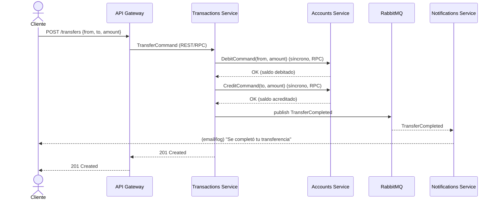

# Etapa 1 — Análisis de dominio (DDD ligero)

## 1. Visión del negocio

Un mini banco donde un cliente puede:

- Registrarse e iniciar sesión.
- Abrir una cuenta (por ahora: una cuenta de ahorro simple).
- Consultar su saldo y movimientos.
- Depositar, retirar y **transferir** dinero a otra cuenta.
- Recibir una notificación cuando ocurre un movimiento relevante.

Esto es suficiente para tocar los problemas reales de microservicios:
**consistencia entre servicios**, **comunicación asíncrona**, **idempotencia**
y **transacciones que cruzan fronteras de servicio** (la transferencia toca
Accounts en dos cuentas y dispara una notificación).

## 2. Bounded contexts (subdominios)

| Contexto          | Responsabilidad                                        | Es el "dueño" de                              |
| ----------------- | ------------------------------------------------------ | --------------------------------------------- |
| **Auth**          | Identidad, autenticación, autorización                 | Usuario (credenciales, roles)                 |
| **Accounts**      | Cuentas y su saldo                                     | Cuenta, Saldo                                 |
| **Transactions**  | Movimientos de dinero y orquestación de transferencias | Transacción, Saga de transferencia            |
| **Notifications** | Avisar al usuario de eventos relevantes                | Notificación (efímera, sin lógica de negocio) |

Regla de DDD clave: **cada contexto tiene su propio modelo**. Por ejemplo,
Transactions no tiene "la" cuenta completa, solo conoce `accountId` y quizá
una copia local mínima (saldo cacheado) si la necesita — nunca comparte tabla
con Accounts.

## 3. Lenguaje ubicuo (glosario)

- **Cuenta (Account)**: entidad con `id`, `ownerId` (referencia a Auth),
  `balance`, `currency`, `status` (ACTIVE/BLOCKED).
- **Movimiento (Transaction)**: registro inmutable de un cambio de saldo:
  `DEPOSIT`, `WITHDRAWAL`, `TRANSFER_OUT`, `TRANSFER_IN`.
- **Transferencia (Transfer)**: caso de uso que orquesta un `TRANSFER_OUT` en
  la cuenta origen y un `TRANSFER_IN` en la cuenta destino. Es el ejemplo
  perfecto para introducir el patrón **Saga** más adelante.
- **Evento de dominio (Domain Event)**: hecho pasado e inmutable que otros
  servicios pueden reaccionar a él (ej. `AccountOpened`, `MoneyDeposited`).

## 4. Agregados por contexto

- **Auth** → Agregado `User` (raíz: `User`; invariantes: email único, password
  hasheado, nunca se expone el hash).
- **Accounts** → Agregado `Account` (raíz: `Account`; invariante: `balance`
  nunca negativo salvo que definamos sobregiro; toda mutación de saldo pasa
  por métodos del agregado, nunca se actualiza la columna directamente).
- **Transactions** → Agregado `Transaction` (inmutable una vez creado) y un
  proceso/orquestador `TransferSaga` que no es un agregado persistente
  "clásico" sino un _process manager_.
- **Notifications** → No tiene agregado real; es un consumidor de eventos
  que solo persiste (opcional) un log de notificaciones enviadas.

## 5. Comandos vs. Eventos (para no confundirlos)

- **Comando** = intención, puede fallar, va dirigido a un servicio concreto,
  usualmente síncrono vía el Gateway.
  Ej: `OpenAccountCommand`, `WithdrawCommand`, `TransferCommand`.
- **Evento** = algo que ya pasó, no puede fallar, se publica para quien
  quiera escuchar (0 o más consumidores), asíncrono vía RabbitMQ.
  Ej: `AccountOpened`, `MoneyDeposited`, `MoneyWithdrawn`,
  `TransferCompleted`, `TransferFailed`.

## 6. Mapa de flujo — caso de uso "Transferencia" (el más interesante)

Si el segundo `CreditCommand` falla, Transactions debe **compensar**
(revertir el débito) — este es el disparador perfecto para explicar el
**patrón Saga (orquestada)** en la Etapa 6, en vez de usar transacciones
distribuidas (2PC), que es lo que casi nadie usa en microservicios reales.

## 7. Preguntas abiertas para la Etapa 2 (diseño de arquitectura)

1. ¿Debit/Credit entre Transactions y Accounts van por **RPC síncrono**
   (request/response sobre RabbitMQ o HTTP interno) o mejor **eventos +
   estado local en Transactions**? (Propuesta: síncrono para las dos
   escrituras de saldo, porque necesitamos saber si falló antes de
   continuar; eventos para todo lo que es "avisar" hacia afuera).
2. ¿Cómo evitamos procesar el mismo evento dos veces (idempotencia)? Se
   resuelve en Etapa 7 con una tabla de "eventos procesados" por consumidor.
3. ¿Qué pasa si Accounts está caído cuando Transactions intenta debitar?
   Se resuelve con reintentos + circuito de espera, tema de Etapa 7/11.

---

**Siguiente paso (Etapa 2):** diagrama de contenedores (C4), definición
formal de los contratos (DTOs de comandos y payloads de eventos) y decisión
final de mecanismo de comunicación síncrona entre servicios.
