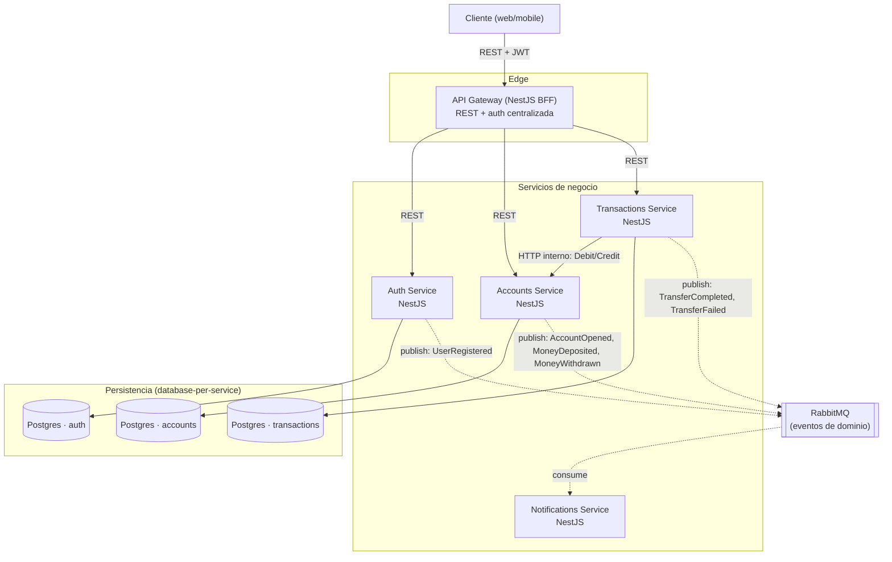

# Etapa 2 — Diseño de arquitectura de microservicios

## 1. Decisión de comunicación síncrona (cierre de la pregunta abierta de Etapa 1)

**Decisión**: Debit/Credit entre `Transactions` y `Accounts` se resuelven vía
**HTTP interno** (REST simple, servicio a servicio). RabbitMQ queda reservado
en exclusiva para **eventos de dominio asíncronos** (Etapa 7).

Razón: simplicidad para razonar sobre el flujo mientras aprendemos Sagas
(Etapa 6); no mezclamos "comando sincrónico que necesita respuesta inmediata"
con el broker que usaremos para "avisos" fire-and-forget. Migrar a
RPC-sobre-RabbitMQ queda como ejercicio opcional más adelante.

> **Nota "nivel senior" a vigilar**: un HTTP call síncrono entre servicios es
> un punto de fallo en cascada si el callee está lento/caído. En Etapa 6/11
> vamos a introducir **timeout explícito + reintentos acotados + circuit
> breaker** (ej. librería `cockatiel` o pattern manual) en el cliente HTTP de
> Transactions → Accounts, en vez de dejar el timeout por defecto del cliente
> HTTP. Lo dejamos anotado aquí para no olvidarlo, pero no lo implementamos
> todavía (todavía no existe el código).

## 2. Diagrama de contenedores (C4 — nivel 2)



Notas:

- `Notifications` no tiene base de datos propia por ahora (consumidor puro,
  ver Etapa 1 §4). Si más adelante queremos historial de notificaciones,
  se añade su propio Postgres — nunca comparte el de otro servicio.
- El Gateway **no** llama directamente a `Notifications`: es un consumidor
  de eventos, no expone API al cliente.

## 3. Contratos entre servicios

### 3.1 Comandos síncronos (HTTP interno, Transactions → Accounts)

```ts
// POST /internal/accounts/:accountId/debit
interface DebitCommand {
  amount: number; // entero, en centavos, nunca float
  currency: string; // ISO 4217, ej. "USD"
  reference: string; // id de la transacción que origina el movimiento (idempotencia)
}

// POST /internal/accounts/:accountId/credit
interface CreditCommand {
  amount: number;
  currency: string;
  reference: string;
}

// Respuesta común (200 OK)
interface AccountMutationResult {
  accountId: string;
  balanceAfter: number;
}

// Error (409 Conflict, ej. fondos insuficientes)
interface AccountMutationError {
  code: 'INSUFFICIENT_FUNDS' | 'ACCOUNT_NOT_FOUND' | 'ACCOUNT_BLOCKED';
  message: string;
}
```

`reference` es clave: es el `transactionId` generado por `Transactions`, y
`Accounts` lo debe usar como clave de idempotencia (no aplicar dos veces el
mismo débito/crédito si la llamada se reintenta). Esto se implementa en la
Etapa 5, pero el contrato lo definimos ya para que ambos servicios lo
respeten desde el día uno.

### 3.2 Eventos de dominio (asíncronos, vía RabbitMQ — Etapa 7)

Formato base (todo evento lo cumple, tipo "envelope"):

```ts
interface DomainEvent<T> {
  eventId: string; // UUID, único por publicación
  eventType: string; // ej. "AccountOpened"
  occurredAt: string; // ISO 8601
  payload: T;
}
```

Eventos previstos (payloads mínimos, se refinan en Etapa 7):

| Evento              | Publicador   | Payload clave                                                   |
| ------------------- | ------------ | --------------------------------------------------------------- |
| `UserRegistered`    | Auth         | `{ userId, email }`                                             |
| `AccountOpened`     | Accounts     | `{ accountId, ownerId, currency }`                              |
| `MoneyDeposited`    | Accounts     | `{ accountId, amount, balanceAfter }`                           |
| `MoneyWithdrawn`    | Accounts     | `{ accountId, amount, balanceAfter }`                           |
| `TransferCompleted` | Transactions | `{ transactionId, fromAccountId, toAccountId, amount }`         |
| `TransferFailed`    | Transactions | `{ transactionId, fromAccountId, toAccountId, amount, reason }` |

## 4. Estrategia de datos

- **Database-per-service** confirmado: un Postgres por servicio con
  esquema propio, sin joins cross-servicio ni tablas compartidas.
- Ningún servicio consulta la base de otro directamente. Toda lectura
  cross-contexto pasa por API (HTTP interno) o por proyección local
  construida a partir de eventos consumidos (ej. si `Transactions` quisiera
  cachear un saldo, lo haría escuchando `MoneyDeposited`/`MoneyWithdrawn`,
  nunca leyendo la tabla de `Accounts`).

## 5. Próximo paso (Etapa 3)

Setup del monorepo: gestor de paquetes (npm workspaces vs pnpm), estructura
de carpetas (`services/`, `gateway/`, `libs/`), linter/formatter compartido,
y `docker-compose` base con Postgres x3 + RabbitMQ (sin código de negocio
todavía, solo infraestructura arrancando).
